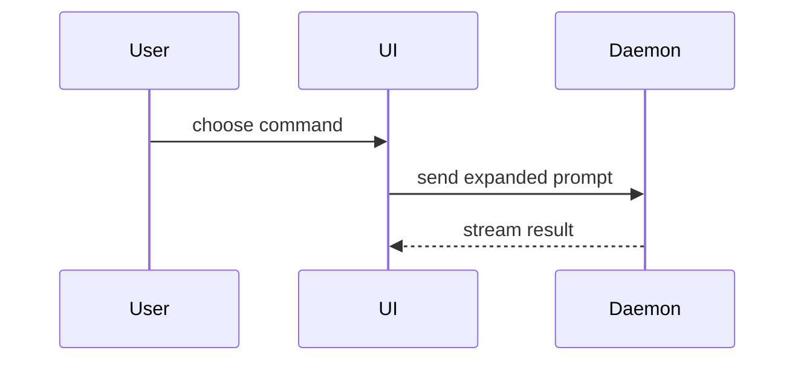

# Pull requests

1. **Scope:** Use the requested base branch, otherwise the remote default. Fetch it and inspect the shipping diff against its merge-base:

   ```bash
   git fetch origin <base>
   git diff "origin/<base>...HEAD"
   ```

   Keep unrelated working-tree edits out of the PR. Commit and push only when authorized. Describe what the branch ships, not pending plans.

2. **Evidence:** Follow the repository's completion gate when it defines one (the documented definition of done and required checks). Otherwise, run the checks the change can affect and record the exact command and observed result for each. Reuse passing checks for unchanged code, but re-run anything the final diff could invalidate. Report failures, skipped checks, and unavailable environments as blockers, never as passes. Add manual QA with expected outcomes only when useful.

3. **Body:** Follow the repository's PR template when one exists, keeping its required sections and adding any of the sections below that it lacks; otherwise use the template below as written. Explain the change, verification, and relevant risks and rollback. Use the user's domain language from `GLOSSARY.md` (or the per-context glossary that `GLOSSARY-MAP.md` points at). When the repository asks for agent attribution, record the actual tool and exact model identifier from the active session, one pair per contributor, and mark unavailable identities explicitly rather than guessing or using a generic AI-assistance footer.

4. **Submit only when asked:** Require passing checks and an authorized pushed branch. Write the finished body to a file outside the repository, such as `/tmp/pr.md`. Check `gh pr list --head <branch>` first. For a new PR:

   ```bash
   gh pr create --base <base> --head <branch> --title '<title>' --body-file /tmp/pr.md
   ```

   Match the repository's title convention, often `<type>(<scope>): <change>`. For an existing PR, use `gh pr edit <number> --body-file /tmp/pr.md`; add `--title` when the title needs updating. Never create a duplicate, push directly to `master`/`main`, or merge the PR yourself.

Done: the body matches the final shipping diff and observed evidence, every template placeholder is resolved, any required attribution records the observed tool and model or marks those identities unavailable, and unrelated edits remain untouched. Do not open a second PR for the same branch.

## Body template

````markdown
## Summary

<diagram, diff sketch, tree, or short paragraph>

## Added / removed

```diff
- Previous behavior or capability
+ Replacement behavior or capability
```

## Evidence

- **Before:** <screenshot/output/failing test run>
  **After:** <screenshot/output/passing test run>

## Merge Danger

**Door:** <one-way or two-way>

<optional: description>

**Blast Radius:** <one-word description>

**Rollback:** <how to undo, or why none exists>

<optional: potential ramifications of merge>
````

## Sections

Skip all preambles and keep prose brief.

### Summary

Pick the smallest view that makes the key point clear. A short paragraph is fine when a visual adds nothing.

- Show logic or an algorithm as pseudocode:

```text
on(save)
  if content is unchanged
    return cached result
  write new content
  return fresh result
```

- Show runtime control flow as a call tree:

```text
submitForm
  createSession
    persistPrompt
    launchAgent
  navigateToSession
```

- Show UI structure as a component tree, including state and module boundaries that matter:

```text
<SessionPage> (apps/example/src/routes/session.tsx)
  useSessionEvents()
  <SessionToolbar>
    <RunSkillButton> (packages/ui)
```

- Show file responsibility or a broad refactor as a shallow file tree:

```text
src/
├── commands/       # parses user actions
├── sessions/       # owns session state
└── transport/      # sends API requests
```

- Show component interaction, control flow, or data flow with Mermaid:



- Use `diff` when the point is what changes and the surrounding shape already exists. Match the diff shape to the topic.

For a component change:

```diff
 <SessionPage>
   useSessionEvents()
   <SessionToolbar>
+    <RunSkillButton />
   <SessionTimeline>
+    <SkillResultCard />
```

For a file-layout change:

```diff
 src/
 ├── commands/
+│   └── show-me.ts       # expands the slash command
 ├── sessions/
-└── transport.ts
+└── transport/
+    ├── client.ts
+    └── stream.ts
```

For a call-tree or call-stack change:

```diff
 submitForm
   createSession
     persistPrompt
+    expandSkillMention
     launchAgent
-  navigateToSession
+  navigateToSession
+    subscribeToEvents
```

For a state or control-flow change:

```diff
 on(save)
-  write content
+  if content is unchanged
+    return cached result
+  write new content
+  invalidate cache
```

- Show the whole block when most of it is new, when omitted context would hide ownership or order, or when the user needs a copyable target shape:

```ts
function expandSkill(command: string): string {
  const skillName = command.slice(1);
  return `use the ${skillName} skill`;
}
```

#### Guidance

Place each visual next to the short text it supports. Keep only the calls, files, props, states, and boundaries needed to answer the user's current question or the options to resolve the current discussion point.

You may use one of these, you may use several, it is unlikely you will use all of them. Use your judgement and don't overwhelm the user. For a behavior-only change, put the detailed before and after in Added / removed instead of repeating the diff here.

### Added / removed

Use a fenced `diff` block to describe the shipping change in plain language. Pair each `-` line describing removed or previous behavior with a `+` line describing its replacement. Use standalone `+` or `-` lines for genuinely one-sided changes; do not invent prior behavior. Summarize behavior or capabilities, not file counts, line counts, or raw code hunks. GitHub highlights additions green and removals red.

### Evidence

Concrete evidence that the change works. Show a before and after.

Screenshots are S-tier - when the environment is set up for it and the change is visual.

Execution-based evidence is A-tier. Test results, console output. Show the exact test that now fails and passes, using pseudocode.

Record the exact commands and observed results. Reuse passing checks for unchanged code, but re-run anything the final diff could invalidate. Failures, skipped checks, and unavailable environments are blockers, not passes. Manual QA is optional; list expected outcomes when included.

### Merge Danger

Describe whether it's a one-way or two-way door. You can walk back through two-way doors, but not one-way doors. A PR that is cheap to roll back is lower risk. Changes that involve destructive actions or hard-to-reverse decisions are one-way doors.

The blast radius is the potential impact or scope of the changes introduced by this PR. Consider all possibilities. Examples are layout shift, breakages for consumers, mobile responsiveness, etc.

State the concrete rollback path, or why none exists. A one-way door still needs a recovery plan, such as restoring from backup or rolling forward.
