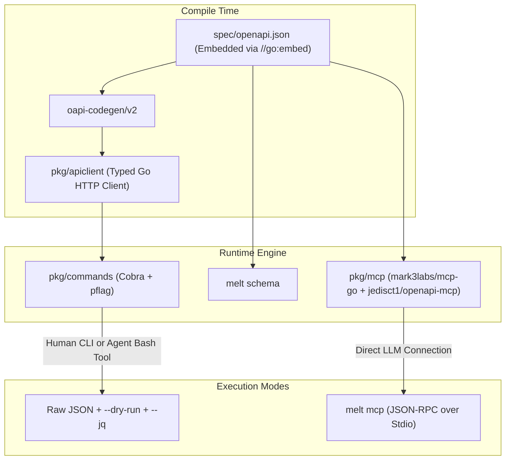

# Open-Source Ecosystem Guide: SaaS-to-CLI, OpenAPI, and MCP in Go

A curated analysis of permissive open-source repositories (MIT, Apache 2.0, BSD) implementing SaaS-to-CLI generation, Model Context Protocol (MCP) bridges, and agent-first terminal patterns.

---

## 1. Comparative Matrix

| Project | License | Tech Stack | Role in Ecosystem | Key Architectural Pattern |
| :--- | :--- | :--- | :--- | :--- |
| [**stripe/stripe-cli**](https://github.com/stripe/stripe-cli) | Apache-2.0 | Go, Cobra, Viper | SaaS-to-CLI (API-driven) | Auto-generates resource commands from OpenAPI (`pkg/cmd/resources_cmds.go`); generic `NewNamespaceCmd` hierarchy; webhook tunneling. |
| [**cli/cli**](https://github.com/cli/cli) & [**cli/go-gh**](https://github.com/cli/go-gh) | MIT | Go, Cobra, gojq | SaaS-to-CLI (Gold Standard) | Strict stream isolation; `--json` field selection + built-in `--jq` via `gojq`; generic `gh api` endpoint escape hatch; cross-platform keyring auth. |
| [**supabase/cli**](https://github.com/supabase/cli) | Apache-2.0 | Go, Cobra, oapi-codegen | SaaS Management CLI | Generates typed Go client from OpenAPI via `oapi-codegen` in `pkg/api`; automated API sync CI workflows. |
| [**danielgtaylor/openapi-cli-generator**](https://github.com/danielgtaylor/openapi-cli-generator) | MIT | Go, Cobra, Viper | Spec-to-CLI Generator | Compiles OpenAPI 3 specs into executable Cobra command trees, handling path parameters, request bodies, and flag coercions. |
| [**mark3labs/mcp-go**](https://github.com/mark3labs/mcp-go) | MIT | Go | Official/Primary Go MCP SDK | Production Go implementation of Model Context Protocol (MCP); supports stdio, SSE, and HTTP transports with schema-based tool routing. |
| [**eat-pray-ai/cobra-mcp**](https://github.com/eat-pray-ai/cobra-mcp) | Apache-2.0 | Go, Cobra, mcp-go | CLI-to-MCP Bridge | Turns any existing Cobra CLI into a dual-mode tool: runs as traditional CLI or starts an MCP server (`mycli mcp`) serving tools over stdio/HTTP. |
| [**PlusLemon/mcp-cobra**](https://github.com/PlusLemon/mcp-cobra) | MIT | Go, Cobra, MCP | CLI-to-MCP Bridge | Automatic Cobra command-to-MCP tool reflection; converts Cobra flags and positional arguments into JSON Schema tool properties. |
| [**jedisct1/openapi-mcp**](https://github.com/jedisct1/openapi-mcp) | MIT | Go | OpenAPI-to-MCP Generator | Standalone Go library (`openapi2mcp`) that dynamically converts OpenAPI 3.x specifications into live MCP tool servers without manual code generation. |
| [**criteo/openapi-to-mcp**](https://github.com/criteo/openapi-to-mcp) | MIT | C# / Go / TS | Enterprise OpenAPI to MCP | Enterprise reference bridge translating large-scale OpenAPI endpoints into agent-invocable MCP tool catalogs. |
| [**twilio-labs/mcp**](https://github.com/twilio-labs/mcp) | Apache-2.0 | TypeScript | Public SaaS OpenAPI to MCP | Exposes all Twilio public REST APIs as MCP tools, translating OpenAPI schemas into tool definitions. |

---

## 2. In-Depth Project Breakdowns

### 2.1 Stripe CLI (`stripe/stripe-cli`)
- **Repository**: `https://github.com/stripe/stripe-cli` (Apache-2.0)
- **Relevance**: Best-in-class example of managing a vast SaaS REST API surface (~1,000+ endpoints) inside a single Go binary.
- **Architectural Highlights**:
  - **Dynamic Resource Namespaces**: Rather than hand-writing commands for every Stripe API entity, `pkg/cmd/resources_cmds.go` reads resource metadata and generates Cobra command structures via a unified `NewNamespaceCmd` factory.
  - **Raw API Fallback (`stripe api <path>`)**: Similar to GitHub's `gh api`, allows agents or scripts to query arbitrary or newly released endpoints before dedicated commands are generated.
  - **Determinism & Fixtures**: Provides `stripe fixtures` allowing deterministic API workflows (creating a customer -> attaching payment method -> creating subscription) declared in JSON files.

### 2.2 GitHub CLI (`cli/cli` & `cli/go-gh`)
- **Repository**: `https://github.com/cli/cli` & `https://github.com/cli/go-gh` (MIT)
- **Relevance**: Industry standard for terminal stream ergonomics, authentication, and machine output.
- **Architectural Highlights**:
  - **Output Discipline**: Strict separation between data (`stdout`) and operational status/progress/errors (`stderr`).
  - **Querying without External Tools**: Integrates `github.com/itchyny/gojq` inside the CLI via `--jq`. Subagents running in minimal environments can query, transform, and project JSON fields without needing `jq` installed on the host.
  - **Composable Library (`go-gh`)**: GitHub decoupled the CLI runtime into reusable Go packages:
    - `pkg/api`: REST and GraphQL HTTP clients with automatic auth and rate-limit retries.
    - `pkg/auth`: Sourcing authentication tokens (CLI flags > `GH_TOKEN` / `GITHUB_TOKEN` > config file > OS keychain).
    - `pkg/term`: TTY status, dimensions, and color detection.

### 2.3 Supabase CLI (`supabase/cli`)
- **Repository**: `https://github.com/supabase/cli` (Apache-2.0)
- **Relevance**: Cleanest pattern for maintaining a synchronized Go client from an evolving SaaS OpenAPI specification.
- **Architectural Highlights**:
  - **Type-Safe Code Generation**: Uses `github.com/oapi-codegen/oapi-codegen` to convert the Supabase Management API OpenAPI 3 spec into Go structs and HTTP client logic under `pkg/api`.
  - **API Sync CI**: Automated GitHub Action workflows detect changes in the upstream OpenAPI schema, run code generation, and open pull requests if the API contract changes.

### 2.4 Cobra-to-MCP Bridges (`eat-pray-ai/cobra-mcp` & `PlusLemon/mcp-cobra`)
- **Repositories**: 
  - `https://github.com/eat-pray-ai/cobra-mcp` (Apache-2.0)
  - `https://github.com/PlusLemon/mcp-cobra` (MIT)
- **Relevance**: Directly solves the requirement of making a Go Cobra CLI available to LLM agents via the Model Context Protocol (MCP).
- **Architectural Highlights**:
  - **Dual Mode Binary**: The same CLI binary acts both as a standard command-line utility for developers (`mycli projects list`) and as an MCP server for agents (`mycli mcp --stdio`).
  - **Automatic Reflection**: Inspects Cobra commands, `pflag.Flag` definitions, and descriptions to build the MCP `tools/list` JSON Schema. When the agent calls a tool, the bridge maps tool parameters back to command flags and executes the command handler.

### 2.5 OpenAPI-to-MCP Generator (`jedisct1/openapi-mcp`)
- **Repository**: `https://github.com/jedisct1/openapi-mcp` (MIT)
- **Relevance**: Pure Go library (`openapi2mcp`) that takes raw OpenAPI 3 specifications and immediately produces an MCP server.
- **Architectural Highlights**:
  - **Zero Code-Gen Runtime**: If you prefer not to compile generated Cobra commands for hundreds of SaaS endpoints, `openapi2mcp.ExtractOpenAPIOperations(doc)` parses the OpenAPI spec dynamically at startup (e.g. from an embedded `openapi.json`) and handles LLM tool invocations by dispatching HTTP requests to the SaaS backend.

---

## 3. Recommended Synthesis for `meltiply-cli`

To achieve an Agent-First Go CLI that connects to your remote SaaS application via OpenAPI, combine these open-source patterns:

### Key Technical Decisions:
1. **Core Client**: Generate strongly typed Go models with `oapi-codegen/v2` (following Supabase CLI).
2. **Command Tree**: Structure using `spf13/cobra` with resource grouping (following Stripe CLI).
3. **Agent Introspection**:
   - Provide `melt tools` (outputting static MCP tool definitions for Claude/Cursor/Codex tool use).
   - Provide `melt mcp` using `mark3labs/mcp-go` (allowing the CLI to be launched as a background MCP stdio server).
4. **Token & Data Economy**: Embed `github.com/itchyny/gojq` for `--jq` filtering on stdout, and output all errors and telemetry to `stderr` with actionable `suggestions[]` (following CircleCI CLI & GitHub CLI).
